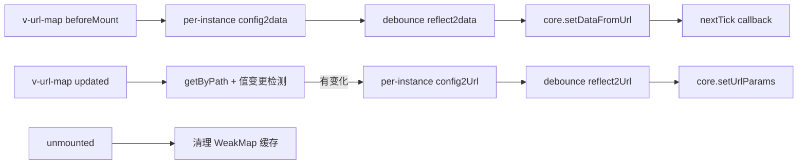

## 产品概述

url-mapper-vue 是一个把 URL 查询参数与 Vue 组件数据双向绑定的库,提供 `v-url-map` 指令和三个实例方法(`$setDataFromUrl`、`$setUrlParams`、`$clearUrlParams`)。本次改造库源码 `src/` 中的指令和插件,补齐并加固 Vue 3 支持。Vue 2 的现有行为保持不变,对外 API 保持兼容。

## 核心功能

- **Vue 3 指令生命周期完整**:在 `beforeMount` 读取 URL 并写入组件数据,在 `updated` 把数据变化同步回 URL,在 `unmounted` 清理残留状态。
- **更新去重**:Vue 3 下只有绑定值真正变化时才写 URL,与 Vue 2 的 `componentUpdated` 行为一致,避免组件任意重渲染都触发 `pushState`。
- **路径解析更稳健**:`value` 支持字符串路径(如 `'model.input'`),兼容 `ref` 自动解包和嵌套对象。路径中间为 `undefined`、`value` 不是字符串等情况不抛错,给出明确提示。
- **配置校验**:`url`、`type`、`value/data` 缺失时给出清晰错误信息。
- **回调**:数据从 URL 写入完成后,在 `nextTick` 中调用配置的 `callback` 方法。
- **插件注入**:在 Vue 3 通过 `app.config.globalProperties`、在 Vue 2 通过 `Vue.prototype` 注入三个方法,版本判断更可靠。
- **文档与示例**:README(中、英)说明 Vue 3 用法和限制(`value` 需写成字符串路径)。Vue 3 示例和端到端测试同步覆盖新行为。

## 技术栈(沿用现有)

- 纯 JavaScript(ESM),无运行时依赖,Vue 2 和 Vue 3 通过同一份源码兼容
- 构建:webpack 5,`lib/index.js` 为产物,由 `npm run build` 生成
- 测试:jest + puppeteer 端到端测试,`local-web-server` 提供 `dist/`,通过 `npm run build:test` 构建 vue2/vue3 示例
- 示例:vue2 为 Element UI(CDN),vue3 为 naive-ui(CDN)

## 实现方案

沿用当前"单指令对象同时包含 Vue 2 和 Vue 3 钩子"的结构,在其内部修复 Vue 3 一侧的缺陷,不引入新架构。

1. **`updated` 去重**:Vue 3 的 `binding.oldValue` 是上一次渲染时的指令值。示例里 `value` 写的是字符串路径,所以 `oldValue.value` 恒等于 `value.value`,不能用它判断数据是否变化。方案是新增一个按元素缓存"上次已同步值"的 `WeakMap<Element, any>`:

- 在 `updated` 时用安全的路径取值函数从 `instance` 取当前值。
- 与缓存值做浅比较,数组按元素比较,对象按 `JSON.stringify` 比较。
- 值变化才写入 `config2Url` 并触发防抖。
- 在 `beforeMount` 和 URL 写入数据后初始化缓存,避免首次渲染误触发。

2. **路径解析抽成 `getByPath(instance, path)`**(放在 `src/core/index.js`,并导出):

- 逐级取值,中间为 `null/undefined` 时返回 `undefined`。
- 同时支持 `$data`、`setup` 返回的 ref(Vue 3 实例代理会自动解包)。
- `setDataFromUrl` 里的赋值逻辑与之对称。当前它写成 `that = this[subPath]`,多级路径(如 `a.b.c`)会错误地总是从 `this` 取,需改为 `that = that[subPath]`。该问题已在代码中确认。

3. **防抖状态按实例隔离**:现有 `config2data`、`config2Url` 是模块级全局变量,多个组件实例或多个 app 同时使用时会串扰。改为以 `instance` 为 key 的 `WeakMap`,分别存放待写入的 data 配置和待写入 URL 的参数。防抖函数按实例各自持有。Vue 2 钩子复用同一套存储,以 `vnode.context` 作为 key。
4. **`unmounted` 清理**:删除 `callbackMap` 中该实例的记录,清除元素缓存,避免内存泄漏。
5. **回调**:`callbackMap` 改为 `WeakMap`。执行回调后清空列表,沿用现有 `$nextTick` 机制。
6. **插件**:`compareVersion` 保留。在 Vue 3 优先读 `app.version`,Vue 2 读 `Vue.version`,缺失时回退到判断 `app.config.globalProperties` 是否存在,避免版本号缺失时判断出错。
7. **错误处理**:校验失败时抛出带有 `v-url-map` 前缀的错误,说明缺少的字段。取值失败时降级为不同步,并用 `console.warn` 提示,不影响页面渲染。

## 实现注意事项

- **兼容性**:Vue 2 钩子(`bind`、`componentUpdated`)的行为和导出结构不变,Vue 2 示例和用例必须保持通过。
- **性能**:`updated` 是热点路径,每次组件更新都会触发。路径取值为 O(路径深度),比较为 O(数组长度)。只有值变化才进入防抖,减少 `pushState` 次数。
- **日志**:只在配置错误或路径取值失败时输出,每个指令实例最多输出一次,避免刷屏。
- **影响范围**:不改动 `setUrlParams` 的序列化规则和 `setDataFromUrl` 的类型转换分支(`number`、`string`、`boolean`、`object`、`array|*`、`arrays|array|*`),只修多级路径取值这一处 bug。
- **构建产物**:源码修改完成后执行 `npm run build` 更新已提交的 `lib/index.js`。
- **依赖**:本机没有 `node_modules`,验证前需先执行 `npm install`。

## 架构



## 目录结构

```
url-mapper-vue/
├── src/
│   ├── core/index.js            # [MODIFY] 新增并导出 getByPath(instance, path);修复 setDataFromUrl 多级路径取值(that = that[subPath]);保持 setUrlParams/clearUrlParams 行为不变
│   ├── directives/url-map.js    # [MODIFY] 重构:per-instance 的 WeakMap 存储(待写入 data、待写入 URL、回调、上次同步值);Vue 3 的 updated 增加值变更检测;新增 unmounted 清理;配置校验与取值降级;Vue 2 钩子复用同一存储且行为不变
│   ├── directives/index.js      # [MODIFY] install 兼容 Vue 3 app 与 Vue 2 构造器,注册 url-map 指令,逻辑保持简单
│   └── plugins/index.js         # [MODIFY] 版本判断增加回退逻辑(app.version / Vue.version / globalProperties 存在性)
├── examples/
│   ├── vue3/index.js            # [MODIFY] 统一为 setup 风格,验证 ref 取值与 callback;保留 naive-ui 与 reset/clearUrl 操作
│   └── vue3/index.html          # [MODIFY] 补充用于验证去重、嵌套路径与 callback 的控件(按需)
├── test/test.js                 # [MODIFY] 增加 vue3 用例:未改动值时 URL 不变化、多级路径、unmounted 后不再写 URL(按需)
├── README.md                    # [MODIFY] 补充 Vue 3 用法、value 字符串路径要求、setup 示例
├── README.en.md                 # [MODIFY] 同步英文文档
├── package.json                 # [MODIFY] 增加 peerDependencies: vue ^2.6.0 || ^3.0.0,并标记为可选
└── lib/index.js                 # [MODIFY] 通过 npm run build 重新生成
```

## 关键结构

```js
// src/core/index.js
export function getByPath (target, path) // 安全逐级取值,中间为 null/undefined 时返回 undefined
```